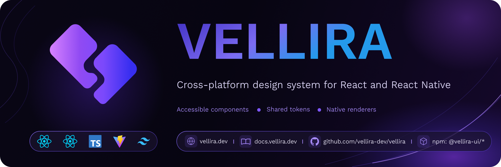

<p align="center">
  
</p>

# Vellira

**Build consistent interfaces for React and React Native — with a shared, verifiable foundation.**

Vellira is an open-source, TypeScript-first cross-platform design system
with reusable components, shared design tokens, native-aware interactions,
and developer quality tooling.

**Where we're heading:** governed cross-platform UI production — a workflow
that connects explicit component intent, implementation, validation, and
maintained consistency. This is the long-term direction, **not a claim that
autonomous production or external-project automation ships today**.

### Available today

- **React + React Native Core:** platform-appropriate components and shared design tokens.
- **Documentation and Storybook:** installation, APIs, examples and interactive demos.
- **Quality tooling:** public metadata, automated tests and validation infrastructure.
- **Dashboard Starter:** free, runnable React Web and React Native / Expo examples.

[](https://www.npmjs.com/package/@vellira-ui/react)
[](https://www.npmjs.com/package/@vellira-ui/react)
[](https://github.com/vellira-dev/vellira/blob/main/LICENSE)
[](https://github.com/vellira-dev/vellira/actions/workflows/ci.yml)

## Try Vellira

The free **Vellira Dashboard Starter** demonstrates published Core components,
editable sample projects, themes, and local persistence. No Vellira account,
backend or Pro subscription is needed.

- [Live Dashboard Web demo](https://vellira.dev/demo/dashboard)
- [Web + React Native / Expo Starter source and instructions](https://github.com/vellira-dev/vellira/blob/main/examples/workspace-starter/README.md)
- [Component documentation](https://docs.vellira.dev/)
- [Interactive Storybook](https://storybook.vellira.dev/)

The Starter uses fictional data and local storage. It is **not** an
authenticated, multiuser production SaaS app. Consult its README for
setup and limitations.

## Packages

| Package | Purpose |
| --- | --- |
| [`@vellira-ui/react`](https://www.npmjs.com/package/@vellira-ui/react) | React components |
| [`@vellira-ui/react-native`](https://www.npmjs.com/package/@vellira-ui/react-native) | React Native components |
| [`@vellira-ui/tokens`](https://www.npmjs.com/package/@vellira-ui/tokens) | Shared design tokens |
| [`@vellira-ui/core`](https://www.npmjs.com/package/@vellira-ui/core) | Shared interaction logic |
| [`@vellira-ui/icons`](https://www.npmjs.com/package/@vellira-ui/icons) | Icons |
| [`@vellira-ui/types`](https://www.npmjs.com/package/@vellira-ui/types) | Shared TypeScript types |

### React quick start

```sh
pnpm add @vellira-ui/react
```

```tsx
import '@vellira-ui/react/styles';
import { Button } from '@vellira-ui/react';

export function Example() {
  return <Button color='primary'>Continue</Button>;
}
```

React Native uses its own renderer and native interaction behavior. See the
[installation documentation](https://docs.vellira.dev/) for platform requirements.

## Product direction

**In development or planned:** broader governed UI workflows and AI-assisted
developer tooling, along with Vellira Pro.

These are not currently shipping features of the free public Core packages.
We will describe production capabilities as available only when they have
repeatable, reviewable evidence.

## Project and people

- [Main GitHub repository](https://github.com/vellira-dev/vellira)
- [Website](https://vellira.dev/)
- [Documentation](https://docs.vellira.dev/)
- [Bug reports and feedback](https://github.com/vellira-dev/vellira/issues)
- **Founder and product/architecture lead:** [Roman Bakurov](https://github.com/romanbakurov)

Vellira's Core is open source. Future commercial offerings will be distinct
from the free Core packages.
